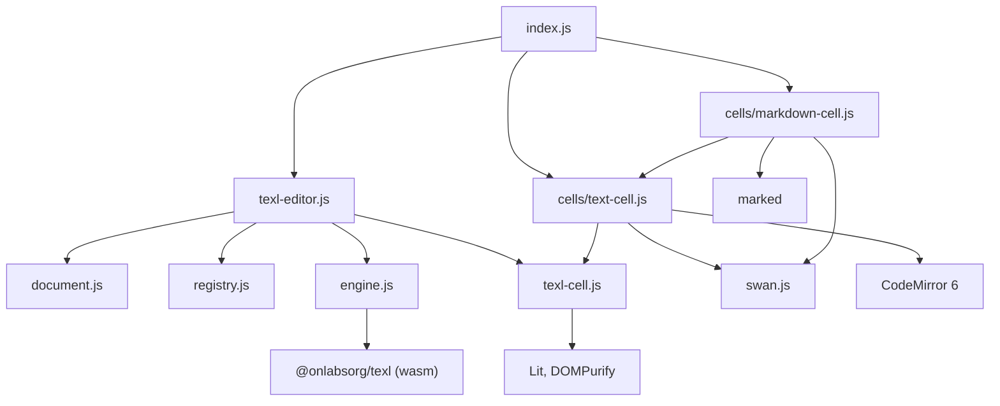
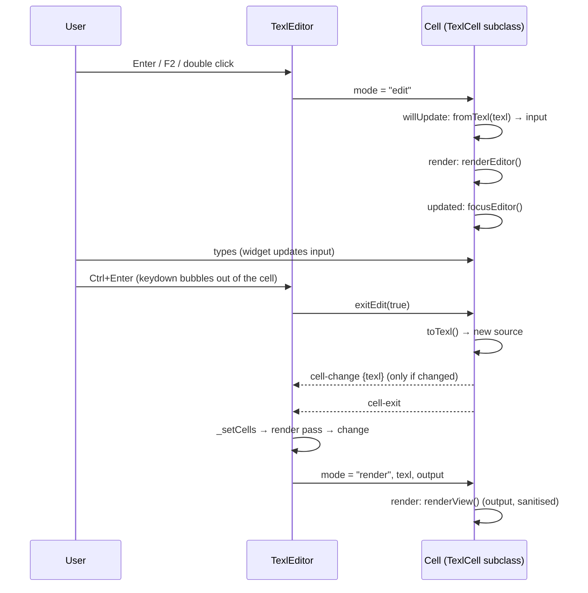

# The editor

*How the editor (`web/src/editor/`) is built: its modules, its classes and how they interact.
Each section links to the [API reference](../component/api.md) for the details. For the
editing model and the decisions behind it, see [design.md](editor-design.md).*

## Overview

The library is plain JavaScript (ES modules, JSDoc types, no build step for
the source) made of [Lit](https://lit.dev) web components. It has one rule
that shapes everything else:

> **The editor owns the document; cells are views of their Texl source.**

The document is a list of cells, each a `{type, name, texl}` record. The
`<texl-editor>` element holds that list and is the only thing that changes
it. Each cell element receives its source (`texl`) and its rendered output
(`output`) as properties, and reports an edit by an event. No data lives
in the cell elements beyond the edit in progress, so the document is always
exactly the text that is saved.

```
                ┌─────────────────────────── <texl-editor> ─────────────────────────┐
  value ──────▶ │ parseDocument ─▶ cells [{type,name,texl}] ─▶ serializeDocument │ ──▶ value
  (text)        │                    │          ▲                                    │    (text)
                │       render pass  │          │ cell-change {texl}                 │
                │ (render + split)   ▼          │                                    │
                │   outputs[] ─▶ <texl-cell-markdown .texl .output .mode>            │ ──▶ change,
                │                <texl-cell-text …>  <texl-cell-quantity …>  …       │     selection-change,
                └────────────────────────────────────────────────────────────────────┘     comments-click,
                                                                                            name-conflict
```

## Modules

| Module                        | Role | Depends on | API |
|-------------------------------|------|------------|-----|
| `web/src/editor/index.js`                | Entry point: registers the built-in cells, defines `<texl-editor>`, re-exports the public API | all | [Importing](../component/api.md#importing) |
| `web/src/editor/texl-editor.js`          | `TexlEditor`: holds the cells, selection, undo history, keyboard, clipboard, type menu, rendering | document, registry, engine, texl-cell | [`<texl-editor>`](../component/api.md#texl-editor) |
| `web/src/editor/texl-cell.js`            | `TexlCell`: base class of the cells; modes, layout, commit protocol | Lit, DOMPurify | [`TexlCell`](../component/api.md#texlcell) |
| `web/src/editor/cells/text-cell.js`      | `TextCell`: Texl template edited in CodeMirror 6; fallback type | texl-cell, swan, CodeMirror | [`TextCell`](../component/api.md#textcell) |
| `web/src/editor/cells/markdown-cell.js`  | `MarkdownCell`: `TextCell` with Markdown highlighting and Markdown output | text-cell, swan, marked, DOMPurify | [`MarkdownCell`](../component/api.md#markdowncell) |
| `web/src/editor/registry.js`             | Maps cell types to custom element tags | — | [Cell registry](../component/api.md#cell-registry) |
| `web/src/editor/document.js`             | The file format: parse, serialise, names, comments, split a rendering. Pure functions, no DOM | — | [Document functions](../component/api.md#document-functions) |
| `web/src/editor/engine.js`               | Loads the Texl WebAssembly module once, creates engines | `@onlabsorg/texl` | [Engine](../component/api.md#engine) |
| `web/src/editor/swan.js`                 | Swan highlighting and the tag/comment commands for CodeMirror | CodeMirror | [Swan helpers](../component/api.md#swan-helpers) |

The dependency graph has no cycles. The bottom layer (`document.js`,
`registry.js`, `engine.js`, `swan.js`) knows nothing about the editor; the
cells know nothing about the editor either, only the events they fire.



## The file format: `document.js`

A document is one Texl text file. `parseDocument` splits it at marker lines,
`<!--{ name : type }-->`, into `CellData` records; `serializeDocument` joins
them back. The round trip is exact, so opening and saving a file without
edits leaves it byte for byte the same.

```js
import { parseDocument, serializeDocument } from "stilo-editor/index.js";

const cells = parseDocument(`Notes
<!--{ bek4 : markdown }-->
# Beam <% L = 6 %>
`);
// [ { type: "text", marker: false, texl: "Notes\n" },
//   { type: "markdown", name: "bek4", texl: "# Beam <% L = 6 %>\n" } ]

serializeDocument(cells);   // the same text
```

- Text before the first marker becomes a `text` cell with `marker: false`,
  so any plain Texl file opens in the editor.
- `nameCells` gives every cell with a marker a unique random name (`bak7`);
  `nameConflicts` finds names shared by hand-edited cells.
- `cellComments` extracts the cell comments, `<!--[ ... ]-->`.
- `splitRendering` cuts the rendering of a whole document into the outputs
  of its cells, at the cells' marker lines.

The module is pure: no DOM, no Texl. It can run anywhere, e.g. on a server.
→ [Document functions](../component/api.md#document-functions)

## The editor: `TexlEditor`

`TexlEditor` (`web/src/editor/texl-editor.js`) is the application. Its state is a few
private reactive properties:

| State        | Meaning |
|--------------|---------|
| `_cells`     | The document: `CellData[]`. Never mutated; replaced by a new array on each change. |
| `_outputs`   | The rendered output of each cell, from the last rendering pass. |
| `_anchor`, `_selected` | The selection: from the anchor line to the active line. |
| `_editing`   | The line in edit mode, or -1. |
| `_menu`, `_menuItem` | The line whose type menu is open, and its highlighted item. |
| `_undoStack`, `_redoStack` | Earlier states `{cells, anchor, selected}` (not reactive). |

### Rendering the sheet

`render()` draws one grid row per line: left margin, cell element, right
margin. The sheet has `max(rows, cells.length)` lines; lines below the
document show an empty `markdown` cell that is not part of the document.

For each line the editor asks the registry which element to use
(`cellTagName(type)`) and creates it with Lit's static templates, binding
the cell's state as properties:

```js
// Simplified from TexlEditor.render()
const tag = unsafeStatic(cellTagName(cell.type));
html`<${tag}
    .texl=${cell.texl}
    .output=${this._outputs[i]}
    .mode=${i === this._editing ? "edit" : "render"}
    .selected=${isSelected}
    @cell-change=${(e) => this._onCellChange(i, e.detail.texl)}
    @cell-exit=${() => this._onCellExit()}
></${tag}>`;
```

So a custom cell type gets the same treatment as a built-in one.

### Changing the document

Every change goes through one method, `_setCells(cells)`:

1. push the current state on the undo stack (at most 100) and clear redo;
2. drop empty `markdown`/`text` cells at the end (they look like the empty
   lines below the document);
3. make sure only the first cell goes without marker, and name unnamed
   cells (`nameCells`);
4. check for name conflicts and fire `name-conflict` if they changed;
5. start a rendering pass (`rendered`);
6. fire `change`.

Inserting, deleting, moving, pasting, changing type and committing an edit
all build a new cell array and call `_setCells`. Undo and redo swap whole
states, which is cheap because cell arrays are never mutated. Setting
`value` replaces the cells directly and clears the history, without firing
`change`.

### Rendering the Texl

```js
// TexlEditor._renderCells()
const generation = ++this._generation;
const cells = this._cells;
this._engine ??= createEngine();
const engine = await this._engine;
let outputs = [];
try {
    const doc = await engine.render(this.url, serializeDocument(cells));
    outputs = splitRendering(doc.rendering, cells);
} catch {
    // The URL cannot be resolved: the cells show no output
}
if (generation === this._generation) this._outputs = outputs;
```

- One engine per editor, created on the first pass and freed when the
  editor leaves the page. It holds configuration only: every pass starts
  from a new scope and fetches the imports again, so `url` may change at
  any time (the editor renders again) and a changed library shows on the
  next pass.
- One **rendering** per pass, of the whole document as the document at
  `url`: what any other Texl host renders, imports included, with each cell
  seeing the names bound above it. `splitRendering` (`document.js`) cuts it
  into the cells' outputs at their own marker lines, in order; the rules
  (foreign markers, missing markers, line breaks) are in
  [design.md](editor-design.md#rendering).
- Passes are asynchronous (imports are promises). A generation counter
  discards a pass that a newer change overtook.
- The whole document renders on every change. Incremental rendering is an
  open point in [design.md](editor-design.md).

→ [`<texl-editor>`](../component/api.md#texl-editor)

### Keyboard, clipboard and menu

The editor listens to `keydown` on itself. Keys from the cells reach it
because keyboard events are composed and bubble out of shadow roots. The
rules:

- an event already default-prevented (by a cell) is ignored;
- with the type menu open, the menu takes every key;
- in edit mode, only Mod+Enter (commit) and Escape (discard) are handled:
  the editor calls `exitEdit(commit)` on the editing cell;
- otherwise the navigation and cell keys apply (see
  [Keyboard](../component/api.md#keyboard)).

Copy, cut and paste use the browser's clipboard events rather than keys, so
every platform shortcut works. The clipboard holds the selected cells as
Texl with their markers (`serializeDocument`); a paste parses it
(`parseDocument`) and renames pasted cells whose names are already in use.

## Cells: `TexlCell` and its subclasses

```
LitElement
  └─ TexlCell                 modes, lined-paper layout, commit protocol, renderView
       ├─ TextCell            CodeMirror editor, Swan highlighting   (type "text")
       │    └─ MarkdownCell   Markdown highlighting and output       (type "markdown")
       └─ your cells          e.g. QuantityCell (type "quantity")
```

### The cell life cycle

A cell is in **render mode** (shows `renderView()`) or **edit mode** (shows
`renderEditor()`). The editor switches it by setting `mode`.



Escape follows the same path with `exitEdit(false)`: no `toTexl()`, no
`cell-change`, only `cell-exit`.

The contract for a subclass is three methods:

```js
class MyCell extends TexlCell {
    static type = "mine";
    fromTexl(texl) { this.input = parse(texl); }       // source → widget input
    toTexl() { return generate(this.input); }          // widget input → source
    renderEditor() { return html`…uses this.input…`; } // the widget
}
```

The guide builds a complete example:
[Write your own cell type](../component/guide.md#7-write-your-own-cell-type).
→ [`TexlCell`](../component/api.md#texlcell)

### `TextCell` and `MarkdownCell`

`TextCell` edits the source itself in a CodeMirror 6 view. The view is
created in `updated()` when the cell enters edit mode and destroyed when it
leaves, so a document with hundreds of cells has at most one editor alive.
A CodeMirror update listener keeps `input` current; the line break that
ends the body belongs to the file format and is kept out of `input`.

Its language comes from `languageExtensions()`: Swan highlighting
(`swanTags()`) and the keymap for Ctrl+Space (insert a tag) and Shift+F2
(insert a comment). `MarkdownCell` adds Markdown highlighting in front of
them, with a small Markdown parser extension so that Markdown does not
interpret what is inside a tag, and overrides `renderView()` to convert its
output with `marked` before sanitising it.

A new text-based cell type follows the same pattern (a sketch;
`latexLanguage` stands for any CodeMirror language support):

```js
class LatexCell extends TextCell {
    static type = "latex";
    static label = "LaTeX";
    languageExtensions() {
        return [latexLanguage(), super.languageExtensions()];
    }
    renderView() { /* typeset this.output, then sanitise */ }
}
```

→ [`TextCell`](../component/api.md#textcell), [`MarkdownCell`](../component/api.md#markdowncell)

## The registry: `registry.js`

A map from cell type (the word in the marker) to custom element tag.
`registerCell(CellClass)` defines `texl-cell-<type>` and records it;
`cellTagName(type)` is what the editor uses to pick an element, and returns
the `text` element for unknown types, so a document with a type this page
does not know still opens, shows its source and keeps its type on save.
`cellTypes()` and `cellClass(type)` feed the type menu (labels and icons).

```js
import { registerCell, cellTagName, cellTypes } from "stilo-editor/index.js";

registerCell(QuantityCell);
cellTagName("quantity");   // "texl-cell-quantity"
cellTagName("chart");      // "texl-cell-text" (not registered)
cellTypes();               // ["text", "markdown", "quantity"]
```

→ [Cell registry](../component/api.md#cell-registry)

## The engine: `engine.js`

A thin wrapper around `@onlabsorg/texl`. The WebAssembly module is
initialised once per page, on the first `createEngine()` call, and every
call returns a new `TexlEngine`. An engine holds configuration only
(globals, base URL); each `engine.render(url, source)` evaluates a whole
document in a new scope and resolves its `texl.import`s against `url`.

→ [Engine](../component/api.md#engine), [Texl primer](texl-primer.md)

## Swan highlighting: `swan.js`

Texl finds its tags before any other syntax is read, so a tag is a tag
wherever it is, also inside a Markdown code block. Highlighting follows
that: it is not part of a CodeMirror language but a layer of mark
decorations over it. `findTags` locates `<% … %>` spans (an unclosed tag
runs to the end), and `swanTokens` splits their content into comments,
strings, numbers, names and operators, which get `cm-swan-*` classes.
`insertTag` and `insertComment` are CodeMirror commands that wrap the
selection.

→ [Swan helpers](../component/api.md#swan-helpers)

## Security

Documents come from other people, so their output is untrusted HTML. Every
cell output is sanitised with DOMPurify before it reaches the DOM
(`TexlCell.renderView`, `MarkdownCell.renderView`). Custom cells that
override `renderView()` must do the same.

## Tests

Tests run in a real headless Chrome with `@web/test-runner`, because cells
are custom elements and Texl is WebAssembly: `test/document.test.js` (file
format), `test/cells.test.js` (cell output, highlighting, commands) and
`test/texl-editor.test.js` (editing, keys, clipboard, undo). Run them with
`npm test`.
